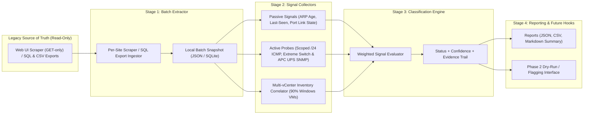

# Architecture & Phased Plan — Inventory Validation System (`sot-validator`)

## 1. Objective & Context

Our internal Source of Truth (SoT) tracks network and server inventory across sites:
- **Site**: Address, contact info, room list
  - **Network Devices**: Switches/routers, ports (with mapping), operational commands (enable/disable port, PoE control, etc. — *strictly off-limits in Phase 1*)
  - **VLANs / Subnets**
  - **IP Addresses**: Device assignments, ARP discovery data
  - **Network-Attached Equipment**: Servers, SANs, UPSs, VMs, etc.

Over time, records in the legacy SoT drift from physical and virtual reality. We need a **read-only, batch-oriented validation system** that extracts records in controlled batches, correlates multiple passive and active validation signals, and classifies every item into one of four actionable states:
1. `Confirmed Active`
2. `Stale / Likely Unused`
3. `Unreachable / Needs Manual Review`
4. `Insufficient Data`

---

## 2. Confirmed Environment Profile & Discovery Findings

| Dimension | Confirmed Environment Detail | Architectural Implication |
| :--- | :--- | :--- |
| **SoT Access Mechanism** | **No formal API** — relies on **Web UI Scraping** and/or **SQL / CSV Exports** | Stage 1 (`SoTClient`) must prioritize a **SQL/CSV Export Adapter** and a **Read-Only HTML Scraper Adapter** (strictly `GET`-only; never submit forms/POSTs that trigger port enable/disable or PoE changes). The GET/HEAD rule is enforced at the transport by `ReadOnlyHttpGuard`, and on-disk SQLite exports are opened read-only (`mode=ro`, `query_only`). |
| **SoT Rate Limits** | **None explicitly enforced** | No artificial API gateway quota, but batching per site (`10.x.0.0/16`) with polite concurrency and per-site checkpointing protects the legacy web/DB server. |
| **Network Topology & Scale** | **~100 Sites**, each assigned a **`10.x.0.0/16`**, with **~10 active `/24` blocks per site** | Never sweep full `/16` ranges (65k IPs/site). Scope all extraction and active probing strictly to recorded SoT IP assignments and the ~10 allocated `/24` subnets per site. |
| **Hypervisors & VMs** | **Multiple VMware vCenter instances**; **~90% of VMs are Windows** | Multi-vCenter collector correlating across instances via BIOS UUID / MoRef / MAC / IP / hostname. Because Windows Firewall frequently drops ICMP ping by default, vCenter power state + VMware Tools heartbeat + ARP/port state must outweigh failed ICMP pings on Windows VMs. |
| **Network Switches** | Primarily **Extreme Networks** | Passive port/ARP signals from SoT complemented by SNMP `IF-MIB` (`ifAdminStatus`, `ifOperStatus`, `ifLastChange`), `IP-MIB` (`ipNetToMediaTable` / `ipNetToPhysicalTable`), and Extreme PoE/LLDP MIBs where reachable. |
| **UPS Equipment** | Primarily **APC** | Validate via ICMP and SNMP (`SNMPv2-MIB::sysUpTime`, `sysDescr`, APC `PowerNet-MIB` identity/status OIDs) or HTTPS management card reachability. |

---

## 3. High-Level Architecture

The system is decoupled into four sequential, batch-driven pipeline stages so that extraction, signal probing, classification, and reporting can run independently and resume from local state without repeatedly hitting the legacy SoT.

### Signal Priority & Cost Hierarchy
To minimize load on both the legacy SoT and live network infrastructure, signals are evaluated in order of lowest cost / highest passivity first:
1. **Tier 1 — Passive SoT Metadata (Zero Network Overhead)**:
   - Recent ARP discovery timestamps already recorded in SoT
   - Last-seen timestamps on devices/IPs/equipment
   - Recorded Extreme switch port operational status / link state and PoE draw
2. **Tier 2 — Multi-vCenter Inventory Correlation (Low Overhead, Bulk Read)**:
   - Query or ingest across multiple VMware vCenter instances (power state, VMware Guest Tools status/heartbeat, guest NIC IP/MAC bindings)
   - Critical for the ~90% Windows VM fleet where Windows Defender Firewall may block ICMP echo requests
3. **Tier 3 — Scoped Active Network Probes (Bounded Concurrency, `/24`-Scoped per Site Batch)**:
   - ICMP echo (ping) sweeps restricted strictly to assigned SoT IPs / allocated `/24` blocks within each site's `10.x.0.0/16`
   - Read-only SNMP (`sysUpTime`, `ifOperStatus`, ARP tables, Extreme switch MIBs, APC UPS `PowerNet-MIB`) or HTTPS management UI reachability checks

---

## 4. Classification Matrix

| Classification | Criteria Summary | Example Evidence |
| :--- | :--- | :--- |
| **Confirmed Active** | At least one strong positive recent signal (within active threshold, e.g., ≤ 7 days). | Recent ARP entry, Extreme switch port link UP, ICMP reply, SNMP response (Extreme switch / APC UPS), or vCenter VM powered ON with active Guest Tools. |
| **Stale / Likely Unused** | Sufficient signal coverage exists, and all signals consistently indicate inactivity beyond the stale threshold (e.g., > 30–90 days). | Switch port DOWN for > 60 days, ARP expired/absent, ICMP unreachable, and (if VM) powered OFF or missing across all vCenter instances. |
| **Unreachable / Needs Manual Review** | Conflicting signals or active probes fail despite indications the device should be online, or host firewall blocks probes. | Extreme port link is UP / PoE drawing power, or Windows VM is marked ON in SoT, but ICMP/SNMP probes time out and vCenter/ARP correlation is unavailable. |
| **Insufficient Data** | Record lacks required identifiers or signal collectors could not evaluate the target. | Equipment record has no IP address, no switch port mapping, no vCenter match, and no last-seen timestamp. |

---

## 5. Phased Implementation Plan

### Phase 0: Discovery & Canonical Data Model
- **Issue 1 (Discovery / Source Mapping)**: Map legacy SoT HTML DOM structures (for `GET`-only web scraping) and/or SQL export table schemas, multi-vCenter connection/export details, and SNMP community/credentials for Extreme switches and APC UPSs.
- **Issue 2 (Domain Models)**: Define canonical, normalized data schemas (`Site`, `NetworkDevice`, `Port`, `VLAN`, `Subnet`, `IPAddress`, `ArpEntry`, `Equipment`, `ValidationSignal`, `ValidationResult`).

### Phase 1A: Read-Only Batch Extraction (Scraping & SQL Exports)
- **Issue 3 (Batch Extractor)**: Build the read-only SoT extraction engine supporting SQL/CSV export ingestion and `GET`-only HTML scraping per site (`10.x.0.0/16` batches across ~100 sites), with local snapshot persistence and offline fixtures.

### Phase 1B: Validation Signal Collectors
- **Issue 4 (Passive Signals)**: Implement evaluators for ARP discovery recency, Extreme switch port link/admin/PoE state, and SoT last-seen timestamps.
- **Issue 5 (Active Probes)**: Implement bounded-concurrency ICMP reachability (strictly scoped to allocated `/24` blocks / assigned IPs, never full `/16` sweeps) and SNMP/HTTP collectors tailored for Extreme switches and APC UPSs.
- **Issue 6 (Multi-vCenter VM Correlation)**: Implement multi-instance VMware vCenter correlation (power state, VMware Tools heartbeat, MAC/IP matching) handling the ~90% Windows VM footprint.
- **Issue 62 (Proxmox VE & Docker/Portainer Correlation, `src/sot_validator/signals/proxmox_containers.py`)**: `ProxmoxContainerCollector` emits `VM_POWER_STATE` for homelab/edge Proxmox VE (`:8006`) QEMU VMs and LXC containers and Docker/Portainer (`:9000`) containers, correlating by IP, MAC (Proxmox OUI `bc:24:11`), VMID, and name from read-only snapshots, and `enrich_site_with_guests` links guests to their host via `hypervisor_id` so the topology graph emits `hosts_vm` edges.

### Phase 1C: Classification Engine & Reporting
- **Issue 7 (Classification Engine)**: Implement the rule evaluation engine that combines signals into the 4 target classifications with an explicit evidence trail and configurable thresholds (accounting for Windows VMs blocking ICMP when vCenter/ARP shows active).
- **Issue 8 (CLI & Reporting)**: Build the CLI runner and multi-format report generator (JSON, CSV, Markdown site summaries) with dry-run hooks for Phase 2 SoT write-back/flagging.

### Phase 2: Historical Tracking, Stale Quarantine & Approval-Gated SoT Remediation
A single point-in-time batch run is never enough to automatically decommission production infrastructure. Phase 2 introduces multi-run persistence, quarantine graduation policies, human approval manifests, and reversible write-back/cleanup execution:
- **Validation History & Streak Tracking (`src/sot_validator/history/`)**:
  - Persists validation runs in a local SQLite/JSON ledger (`HistoryStore`), tracking `consecutive_stale_runs`, `first_seen_stale_at`, `last_confirmed_active_at`, state transition drift (`Confirmed Active` → `Unreachable`, `Stale` → `Confirmed Active` resurrection), and `/24` subnet IP utilization trends across the ~100 sites.
  - The SQLite ledger is schema-versioned through `PRAGMA user_version` (`HISTORY_SCHEMA_VERSION`, currently `1`). On open, `HistoryStore` runs the pending entries of the ordered `_MIGRATIONS` list in order, each in its own transaction that also advances `user_version`; a failed migration rolls back and leaves the database at the last committed version. Pre-versioning databases (`user_version` 0) are stamped to `1` with their rows untouched, and a database newer than the code is refused with `HistorySchemaVersionError` before anything is written.
  - Any future schema change must be added as a new migration appended to `_MIGRATIONS`; never edit migration 1 or any other already-released migration.
- **Quarantine Policy & Signed Approval Manifests (`src/sot_validator/remediation/quarantine.py`)**:
  - Promotes items from `Stale / Likely Unused` to **Quarantine / Cleanup Eligible** only when multi-run streak thresholds (`min_consecutive_stale_runs`, `min_stale_days`, `min_confidence`) are met and the item is not on a protected critical-infrastructure allowlist (e.g., core Extreme switches, APC UPSs, or exempted IPs).
  - Exports operator-reviewable **Approval Manifests** with SHA-256 integrity digests and per-action decision states (`PENDING`, `APPROVED`, `REJECTED`, `EXEMPT`).
- **Gated Remediation Executor & Rollback Journal (`src/sot_validator/remediation/executor.py`)**:
  - Consumes only SHA-256-verified, operator-approved manifests (`--execute-approved-plan <path> --confirm-write`; `dry_run=True` remains the default everywhere else).
  - Generates paired forward/rollback SQL scripts (`remediate.sql` + `rollback.sql`) for SQL-backed SoT flagging/IP release, and append-only audit rollback journals (`remediation_journal.jsonl`) capturing pre-change snapshots of every modified record.

### Phase 3: Reverse Discovery (Untracked Inventory Reconciliation), Fleet Campaigns & HTML Operations Dashboard
Once existing SoT records are validated and stale records are safely quarantined, Phase 3 closes the loop by detecting **untracked active equipment ("Shadow IT" / reverse drift)** and enabling continuous 100-site fleet operations:
- **Reverse Discovery & Untracked Asset Reconciler (`src/sot_validator/reconciliation/`)**:
  - Compares live discovery feeds (multi-vCenter powered-on VMs, Extreme switch ARP/MAC tables, and `/24` active ICMP/SNMP probe responses) against the SoT snapshot to identify:
    - `UNTRACKED_VM`: Powered-on Windows/Linux VMs in vCenter missing from the SoT.
    - `UNTRACKED_IP`: Active ARP/ICMP responders in a site's `/24` blocks with no SoT `IPAddress` assignment.
    - `UNTRACKED_DEVICE`: Responding Extreme switches, APC UPSs, or servers not registered in the SoT.
    - `ATTRIBUTE_MISMATCH`: Hostname, MAC address, VLAN, or switch port mapping mismatches between live state and SoT.
  - Generates SoT onboarding/import templates (`CSV` / `SQL INSERT`) to bring untracked active assets under management.
- **Multi-Site Campaign Orchestrator & Alerting (`src/sot_validator/campaign/`)**:
  - Schedules and executes rolling validation waves across site cohorts (`10.x.0.0/16` site batches), enforces outage circuit-breakers (auto-pausing a campaign if an entire site or vCenter spikes to `Unreachable` due to WAN/collector outage), and dispatches structured alert payloads (`AlertSink` for JSON/Webhook/Slack) when critical infrastructure (Extreme switches, APC UPSs) fails validation.
- **Interactive HTML Operations Dashboard & Unified CLI (`src/sot_validator/reporting/dashboard.py`, `src/sot_validator/cli.py`)**:
  - Generates a self-contained, zero-dependency interactive HTML report (`dashboard_report.html`) featuring per-site `/24` subnet health cards, classification charts, stale-streak quarantine queues, untracked asset reconciliation tables, and client-side search/filtering.
  - Extends `python3 -m sot_validator` with `history`, `quarantine`, `remediate`, `reconcile`, and `campaign` subcommands.

### Phase 4: Enterprise Windows/AD & DNS/DHCP Correlation, Extreme Switch Port/PoE Reclamation & Live Pilot Cutover
With ~90% of VMs running Windows and ~100 sites running Extreme Networks switches and APC UPSs, Phase 4 deepens enterprise signal coverage and automates safe switch port & PoE reclamation:
- **Active Directory Computer Account & DNS/DHCP Lease Correlation (`src/sot_validator/signals/directory_dns.py`)**:
  - Correlates SoT server/VM hostnames and IPs against **Active Directory (`lastLogonTimestamp`, `pwdLastSet`, `operatingSystem`, `enabled` account state)**, **DNS (`A`/`PTR` forward/reverse alignment)**, and **DHCP active lease exports** across each site's `/24` subnets.
  - Resolves ambiguous Windows VMs/servers that block ICMP ping or reside on unpolled hypervisors, and detects stale DNS records or static/DHCP scope collisions.
- **LLDP Uplink Guard & Staged Extreme Switch Port / PoE Reclamation Planner (`src/sot_validator/remediation/port_reclamation.py`)**:
  - Evaluates unused Extreme switch access ports (`oper DOWN` and zero ARP/MAC activity across consecutive runs) while enforcing a strict **LLDP / Trunk Uplink Safety Guard** (never proposing shutdown or PoE disablement on inter-switch trunks, router uplinks, WAPs, or APC UPS ports).
  - Generates vendor-specific **ExtremeXOS (`disable ports <port>`, `configure inline-power disable ports <port>`)** and **VOSS** staged change scripts paired with 1-command rollback scripts (`enable ports <port>`).
- **Live Production Connector Transports & Pilot Site Readiness Validator (`src/sot_validator/connectors/`)**:
  - Provides live read-only connector transports (`VSphereRestConnector`, `SnmpWalkConnector`, `AuthenticatedScraperSession`) and a `PilotCutoverValidator` pre-flight check tool that verifies network reachability, credential validity, and schema compatibility for a 3-to-5 site pilot cohort before full 100-site rollout.

### Phase 5: Modern Source of Truth Migration Bridge (NetBox / Nautobot Golden Export & Dual-Run Parity)
Once legacy SoT records are validated, stale records quarantined, and untracked Shadow IT reconciled, Phase 5 enables retiring the aging legacy SoT in favor of a modern open-source Source of Truth (**NetBox** or **Nautobot**) without migrating years of stale junk data:
- **Validated Golden Inventory Exporter (`src/sot_validator/migration/exporter.py`)**:
  - Filters strictly to **`Confirmed Active`** SoT records plus verified **Reconciled Untracked Assets** (excluding `Stale / Likely Unused` quarantined items unless opted in as `decommissioning`) and transforms them into normalized **NetBox / Nautobot** bulk-import payloads (`JSON` / `CSV` / `YAML` bundles covering `Sites`, `VLANs`, `/24 Prefixes`, `DeviceTypes` for Extreme & APC, `Devices`, `Interfaces` with cable/port mappings, `IPAddresses`, `Clusters`, and `VirtualMachines`).
- **Dual-Run Parity Checker & Migration Readiness Scorecard (`src/sot_validator/migration/parity.py`)**:
  - Compares legacy SoT state, live network discovery, and target NetBox/Nautobot state during a dual-run transition period, computing a **Per-Site Migration Readiness Score (`0–100%`)** and flagging any blocking discrepancies before a site's `10.x.0.0/16` cutover.

### Phase 6: APC UPS Fleet Health Telemetry, ITSM Change-Ticket Governance & Continuous Drift Prevention
Phase 6 transitions the system from a periodic validation & migration tool into a continuous fleet governance platform integrated with enterprise ITSM workflows and hardware lifecycle monitoring:
- **APC UPS Battery, Runtime & Environmental Health Evaluator (`src/sot_validator/signals/ups_health.py`)**:
  - Evaluates APC `PowerNet-MIB` telemetry (`upsBasicBatteryStatus`, `upsAdvBatteryReplaceIndicator`, `upsAdvBatteryRunTimeRemaining`, `upsAdvBatteryTemperature`, `upsBasicOutputStatus`, `upsAdvInputLineFailCause`) across all ~100 sites to surface proactive hardware maintenance advisories (`BATTERY_REPLACEMENT_NEEDED`, `LOW_RUNTIME_WARNING`, `ON_BATTERY_ALERT`, `HIGH_TEMP_WARNING`) alongside active reachability.
- **ITSM Change-Ticket & Approval Governance Sink (`src/sot_validator/itsm/`)**:
  - Bridges `RemediationApprovalManifest`, Extreme switch port reclamation plans, APC UPS battery alerts, and Shadow IT onboarding into **ServiceNow / Jira / Generic ITSM Change Request payloads** (`ItsmTicketPayloadBuilder`, `JsonFileItsmSink`, `ItsmGateVerifier`), tracking ticket IDs, approval state transitions, SHA-256 artifact digests, and pre-execution verification gates.
- **Unified Phase 4–6 CLI Subcommands & Extended Operations Dashboard (`src/sot_validator/cli.py`, `src/sot_validator/reporting/dashboard.py`)**:
  - Adds `preflight`, `reclaim-ports`, `export-modern-sot` (`migrate-export`), `parity-check` (`migration-parity`), `ups-health`, and `itsm` (`itsm-sync`) CLI subcommands, wires `--ad-json`, `--dns-json`, `--dhcp-json`, and `--itsm-ticket-id` into validation and remediation workflows, and enriches the air-gapped HTML5 dashboard with NetBox/Nautobot Migration Readiness scorecards (`migration-parity-section`), Extreme Port/PoE Reclamation queues (`port-reclamation-section`), APC UPS Fleet Health panels (`ups-health-section`), and ITSM Change-Ticket Governance tables (`itsm-governance-section`).
