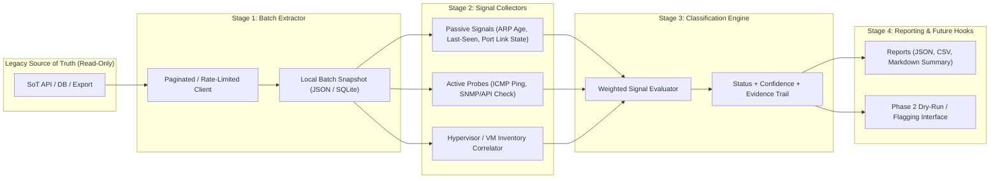

# Architecture & Phased Plan — Inventory Validation System (`sot-validator`)

## 1. Objective & Context

Our internal Source of Truth (SoT) tracks network and server inventory across sites:
- **Site**: Address, contact info, room list
  - **Network Devices**: Switches/routers, ports (with mapping), operational commands (enable/disable port, PoE control, etc. — *strictly off-limits in Phase 1*)
  - **VLANs / Subnets**
  - **IP Addresses**: Device assignments, ARP discovery data
  - **Network-Attached Equipment**: Servers, SANs, UPSs, VMs, etc.

Over time, records in the legacy SoT drift from physical and virtual reality. We need a **read-only, batch-oriented validation system** that extracts records in controlled batches, correlates multiple passive and active validation signals, and classifies every item into one of four actionable states:
1. `Confirmed Active`
2. `Stale / Likely Unused`
3. `Unreachable / Needs Manual Review`
4. `Insufficient Data`

---

## 2. High-Level Architecture

The system is decoupled into four sequential, batch-driven pipeline stages so that extraction, signal probing, classification, and reporting can run independently and resume from local state without repeatedly hitting the legacy SoT.

### Signal Priority & Cost Hierarchy
To minimize load on both the legacy SoT and live network infrastructure, signals are evaluated in order of lowest cost / highest passivity first:
1. **Tier 1 — Passive SoT Metadata (Zero Network Overhead)**:
   - Recent ARP discovery timestamps already recorded in SoT
   - Last-seen timestamps on devices/IPs/equipment
   - Recorded switch port operational status / link state and PoE draw
2. **Tier 2 — External Inventory Correlation (Low Overhead, Bulk API)**:
   - Hypervisor / VM management correlation (vCenter / Proxmox / cloud API power state and last check-in)
3. **Tier 3 — Active Network Probes (Bounded Concurrency, Opt-In per Batch)**:
   - ICMP echo (ping) sweeps across assigned IP addresses
   - SNMP (`sysUpTime`, `ifOperStatus`, ARP table polling) or HTTP/HTTPS API reachability checks against management IPs

---

## 3. Classification Matrix

| Classification | Criteria Summary | Example Evidence |
| :--- | :--- | :--- |
| **Confirmed Active** | At least one strong positive recent signal (within active threshold, e.g., ≤ 7 days). | Recent ARP entry, port link UP, ICMP reply, SNMP response, or VM powered ON. |
| **Stale / Likely Unused** | Sufficient signal coverage exists, and all signals consistently indicate inactivity beyond the stale threshold (e.g., > 30–90 days). | Port administratively/operationally DOWN for > 60 days, ARP expired/absent, ICMP unreachable, or VM powered OFF/decommissioned. |
| **Unreachable / Needs Manual Review** | Conflicting signals or active probes fail despite indications the device should be online, or network ACL/firewall blocks probes. | Port link is UP orPoE is drawing power, or VM is marked ON, but ICMP/SNMP probes time out and no ARP entry is seen. |
| **Insufficient Data** | Record lacks required identifiers or signal collectors could not evaluate the target. | Equipment record has no IP address, no port mapping, no hypervisor link, and no last-seen timestamp. |

---

## 4. Phased Implementation Plan

### Phase 0: Discovery & Canonical Data Model
- **Issue 1 (Discovery / Blocker)**: Audit legacy SoT access methods (REST API vs. DB read replica vs. scheduled CSV/JSON exports), authentication, rate limits, and network probe vantage points/firewalls.
- **Issue 2 (Domain Models)**: Define canonical, normalized data schemas (`Site`, `NetworkDevice`, `Port`, `VLAN`, `Subnet`, `IPAddress`, `ArpEntry`, `Equipment`, `ValidationSignal`, `ValidationResult`).

### Phase 1A: Read-Only Batch Extraction
- **Issue 3 (Batch Extractor)**: Build the read-only SoT client and batch extraction engine with per-site pagination, configurable rate-limiting, retry/backoff, and local snapshot persistence (plus a mock/fixture adapter so development proceeds in parallel with discovery).

### Phase 1B: Validation Signal Collectors
- **Issue 4 (Passive Signals)**: Implement evaluators for ARP discovery recency, port link/admin/PoE state, and SoT last-seen timestamps.
- **Issue 5 (Active Probes)**: Implement bounded-concurrency ICMP reachability and SNMP/API reachability collectors.
- **Issue 6 (VM & Hypervisor Correlation)**: Implement hypervisor inventory correlation for virtual machines and network-attached compute.

### Phase 1C: Classification Engine & Reporting
- **Issue 7 (Classification Engine)**: Implement the rule evaluation engine that combines signals into the 4 target classifications with an explicit evidence trail and configurable thresholds.
- **Issue 8 (CLI & Reporting)**: Build the CLI runner and multi-format report generator (JSON, CSV, Markdown site summaries) with dry-run hooks for Phase 2 SoT write-back/flagging.
